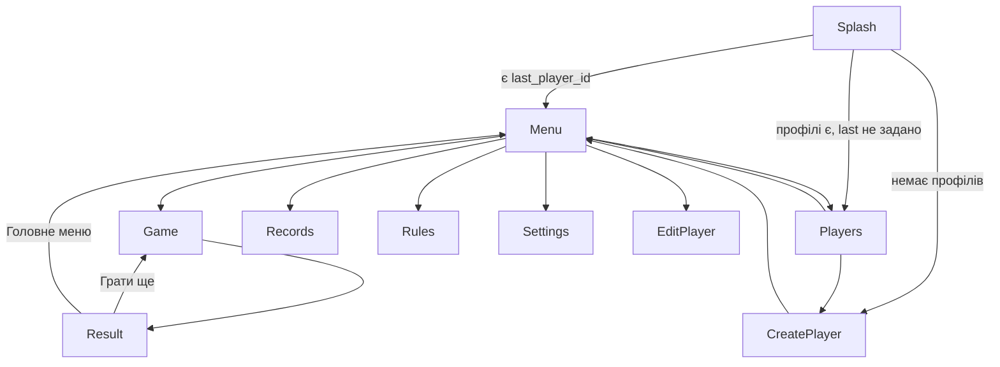

# Технічний дизайн: «Хто хоче стати тисячником?» (Android)

> Документ призначений для реалізації застосунку (зокрема іншою AI-моделлю у режимі вайбкодингу).
> Функціональні вимоги — у [REQUIREMENTS.md](REQUIREMENTS.md). Ідентифікатори вимог (FR-x, QR-x, NFR-x) посилаються на нього.
> Код, ідентифікатори та коментарі — англійською; **усі рядки, видимі користувачеві, — українською** в `strings.xml`.

---

## 1. Технологічний стек

| Компонент | Вибір |
|---|---|
| Мова | Kotlin 2.x |
| UI | Jetpack Compose + Material 3 (Compose BOM, остання стабільна) |
| Навігація | Navigation Compose (type-safe routes через `@Serializable`) |
| Архітектура | MVVM + UDF (`StateFlow<UiState>`), шари `data` / `domain` / `ui` |
| DI | Hilt (KSP) |
| JSON | kotlinx.serialization |
| БД | Room (KSP) |
| Налаштування | Jetpack DataStore (Preferences) |
| Асинхронність | Kotlin Coroutines + Flow |
| Тести | JUnit 4, kotlinx-coroutines-test, Turbine, Compose UI Test |
| Збірка | Gradle Kotlin DSL + version catalog (`gradle/libs.versions.toml`), JDK 17 |
| SDK | `minSdk = 26`, `compileSdk`/`targetSdk` = остання стабільна (≥ 35) |

Один Gradle-модуль `:app`. Package: `com.vibecoding.millionaire`.

---

## 2. Структура проєкту

```
Millionaire/
├── REQUIREMENTS.md
├── TECHNICAL_DESIGN.md
├── settings.gradle.kts
├── build.gradle.kts
├── gradle/libs.versions.toml
└── app/
    ├── build.gradle.kts
    └── src/
        ├── main/
        │   ├── AndroidManifest.xml
        │   ├── assets/
        │   │   └── questions/
        │   │       ├── questions.json      # питання (без правильних відповідей)
        │   │       └── answers.json        # правильні відповіді
        │   ├── res/
        │   │   ├── values/strings.xml      # усі рядки UI українською
        │   │   ├── values/plurals.xml
        │   │   └── raw/                    # звуки (CC0 / власні)
        │   └── java/com/vibecoding/millionaire/
        │       ├── MillionaireApp.kt       # @HiltAndroidApp
        │       ├── MainActivity.kt
        │       ├── di/
        │       │   ├── DatabaseModule.kt
        │       │   └── AppModule.kt        # Random, Dispatchers, Clock
        │       ├── data/
        │       │   ├── questions/
        │       │   │   ├── QuestionDto.kt
        │       │   │   ├── AnswerDto.kt
        │       │   │   ├── QuestionAssetLoader.kt
        │       │   │   └── QuestionBankRepositoryImpl.kt
        │       │   ├── db/
        │       │   │   ├── AppDatabase.kt
        │       │   │   ├── entity/ (PlayerEntity, SeenQuestionEntity, GameResultEntity)
        │       │   │   └── dao/    (PlayerDao, SeenQuestionDao, GameResultDao)
        │       │   ├── PlayerRepositoryImpl.kt
        │       │   ├── GameResultRepositoryImpl.kt
        │       │   └── SettingsRepositoryImpl.kt
        │       ├── domain/
        │       │   ├── model/   (AgeGroup, AnswerOption, Question, Player, PrizeLadder, GameOutcome, Lifeline, ...)
        │       │   ├── repository/ (інтерфейси репозиторіїв)
        │       │   ├── game/
        │       │   │   ├── QuestionSelector.kt
        │       │   │   ├── GameEngine.kt
        │       │   │   ├── LifelineEngine.kt
        │       │   │   └── NicknameValidator.kt
        │       │   └── usecase/ (StartGameUseCase, FinishGameUseCase, ...)
        │       └── ui/
        │           ├── theme/ (Color.kt, Theme.kt, Type.kt, Shapes.kt)
        │           ├── navigation/AppNavHost.kt
        │           ├── components/ (AnswerButton, PrizeLadder, LifelineBar, AudienceChart, ...)
        │           ├── splash/
        │           ├── players/      (вибір/створення профілю)
        │           ├── menu/         (головне меню)
        │           ├── game/         (GameScreen, GameViewModel, GameUiState)
        │           ├── result/
        │           ├── records/
        │           ├── settings/
        │           └── rules/
        └── test/java/com/vibecoding/millionaire/
            ├── data/QuestionBankIntegrityTest.kt
            ├── domain/QuestionSelectorTest.kt
            ├── domain/GameEngineTest.kt
            ├── domain/LifelineEngineTest.kt
            └── domain/NicknameValidatorTest.kt
```

---

## 3. Формат файлів питань

Обидва файли — UTF-8 JSON без BOM, у `app/src/main/assets/questions/`.

### 3.1. `questions.json`

```json
{
  "schemaVersion": 1,
  "questions": [
    {
      "id": 1,
      "text": "Хто є автором збірки «Кобзар»?",
      "options": {
        "A": "Іван Франко",
        "B": "Тарас Шевченко",
        "C": "Леся Українка",
        "D": "Панас Мирний"
      },
      "category": "literature",
      "ratings": [
        { "age": "10-12", "difficulty": 1 },
        { "age": "13-14", "difficulty": 1 }
      ]
    }
  ]
}
```

Поля:

| Поле | Тип | Обмеження |
|---|---|---|
| `id` | Int | > 0, унікальний, ніколи не перевикористовується |
| `text` | String | 10..200 символів, закінчується `?` або `:` |
| `options` | Object | рівно ключі `A`,`B`,`C`,`D`; значення 1..60 символів, попарно різні (без урахування регістру й пробілів) |
| `category` | String | один із ключів §3.4 |
| `ratings` | Array | 1..4 елементи; `age` ∈ {`10-12`,`13-14`,`15-18`,`19-60`} без повторів; `difficulty` ∈ 1..5 |

### 3.2. `answers.json`

```json
{
  "schemaVersion": 1,
  "answers": [
    { "id": 1, "correct": "B" }
  ]
}
```

- `correct` ∈ {`A`,`B`,`C`,`D`} — ключ із `options` відповідного питання.
- Використовується масив (а не об'єкт-мапа), щоб дублікати ID виявлялися тестом, а не перезаписувалися мовчки парсером.
- Записи в обох файлах впорядковані за `id` за зростанням.

### 3.3. Правила додавання питань
1. Новий ID = `max(id) + 1`.
2. Додати запис у кінець `questions.json` і відповідний запис у кінець `answers.json`.
3. Запустити `./gradlew testDebugUnitTest` — тест цілісності має пройти.
4. Питання **не видаляються**, а лише виправляються зі збереженням ID. Це гарантує, що `max(id) + 1` завжди новий і ID ніколи не перевикористовуються.

### 3.4. Тематичні категорії (`category`)

| Ключ | Назва (для документації/статистики) |
|---|---|
| `geography` | Географія |
| `history_ua` | Історія України |
| `history_world` | Всесвітня історія |
| `nature` | Природа та біологія |
| `physics` | Фізика та астрономія |
| `chemistry` | Хімія |
| `math` | Математика та логіка |
| `literature` | Література |
| `language` | Українська мова |
| `art` | Мистецтво та архітектура |
| `music` | Музика |
| `cinema` | Кіно та мультфільми |
| `sport` | Спорт |
| `technology` | Технології та винаходи |
| `food` | Кулінарія та побут |
| `culture` | Традиції, свята, фольклор |
| `health` | Здоров'я та людина |

Категорія в UI першої версії не показується, використовується для балансування банку питань і статистики тесту.

---

## 4. Доменна модель

```kotlin
enum class AgeGroup(val jsonKey: String, @StringRes val titleRes: Int) {
    AGE_10_12("10-12", R.string.age_10_12),
    AGE_13_14("13-14", R.string.age_13_14),
    AGE_15_18("15-18", R.string.age_15_18),
    AGE_19_60("19-60", R.string.age_19_60);

    companion object { fun fromJsonKey(key: String): AgeGroup? = entries.find { it.jsonKey == key } }
}

enum class AnswerOption { A, B, C, D }

data class Question(
    val id: Int,
    val text: String,
    val options: Map<AnswerOption, String>,   // original keys from JSON
    val category: String,
    val difficultyByAge: Map<AgeGroup, Int>,
    val correct: AnswerOption,
)

data class Player(
    val id: Long,
    val nickname: String,
    val ageGroup: AgeGroup,
    val createdAt: Instant,
    val lastPlayedAt: Instant?,
)

enum class Lifeline { FIFTY_FIFTY, ASK_AUDIENCE, PHONE_FRIEND }

enum class GameOutcome { WON, WRONG_ANSWER, WALKED_AWAY }

data class GameResult(
    val playerId: Long,
    val ageGroup: AgeGroup,
    val startedAt: Instant,
    val finishedAt: Instant,
    val correctAnswers: Int,       // 0..15
    val prize: Int,                // UAH
    val outcome: GameOutcome,
    val lifelinesUsed: Set<Lifeline>,
)
```

### 4.1. Драбина виграшів

```kotlin
object PrizeLadder {
    const val QUESTIONS_COUNT = 15
    const val QUESTIONS_PER_DIFFICULTY = 3
    val prizes: List<Int> = listOf(1, 2, 3, 5, 10, 15, 25, 50, 75, 100, 150, 250, 400, 600, 1000)
    val safeHavenIndices: Set<Int> = setOf(4, 9) // 0-based: 5th (10 UAH) and 10th (100 UAH)

    fun difficultyFor(questionIndex: Int): Int = questionIndex / QUESTIONS_PER_DIFFICULTY + 1

    /** Prize after [correctAnswers] correct answers when walking away. */
    fun walkAwayPrize(correctAnswers: Int): Int = if (correctAnswers == 0) 0 else prizes[correctAnswers - 1]

    /** Prize when answering wrong on question with 0-based [questionIndex]. */
    fun wrongAnswerPrize(questionIndex: Int): Int =
        safeHavenIndices.filter { it < questionIndex }.maxOrNull()?.let { prizes[it] } ?: 0
}
```

Перевірка: помилка на 5-му питанні (index 4) → 0 грн; на 6-му (index 5) → 10 грн; на 11-му (index 10) → 100 грн.

---

## 5. Шар даних

### 5.1. Завантаження банку питань

`QuestionAssetLoader` читає обидва файли з `AssetManager` на `Dispatchers.IO`, парсить через `Json { ignoreUnknownKeys = true }`.

`QuestionBankRepositoryImpl`:
- Singleton, ліниве завантаження під `Mutex`; результат кешується в пам'яті (`List<Question>` + індекс).
- Об'єднує DTO за `id`. **Пропускає** (з `Log.w`) питання, що: не мають відповіді; мають дубль ID; невалідні за §3.1. Відповіді без питання ігноруються.
- Будує індекс: `Map<AgeGroup, Map<Int /*difficulty*/, List<Question>>>`.
- Завантаження запускається на Splash-екрані, щоб гра стартувала без затримки.

```kotlin
interface QuestionBankRepository {
    suspend fun getBank(): QuestionBank
}

class QuestionBank(val all: List<Question>) {
    private val byId = all.associateBy { it.id }
    private val index: Map<AgeGroup, Map<Int, List<Question>>> = /* build */
    fun byId(id: Int): Question? = byId[id]
    fun pool(age: AgeGroup, difficulty: Int): List<Question> = index[age]?.get(difficulty).orEmpty()
    fun countFor(age: AgeGroup): Int
}
```

### 5.2. Room

```kotlin
@Entity(tableName = "players", indices = [Index(value = ["nickname_normalized"], unique = true)])
data class PlayerEntity(
    @PrimaryKey(autoGenerate = true) val id: Long = 0,
    val nickname: String,
    @ColumnInfo(name = "nickname_normalized") val nicknameNormalized: String, // trim + lowercase(Locale("uk"))
    val ageGroup: String,          // AgeGroup.name
    val createdAt: Long,
    val lastPlayedAt: Long?,
)

@Entity(
    tableName = "seen_questions",
    primaryKeys = ["playerId", "questionId"],
    foreignKeys = [ForeignKey(PlayerEntity::class, ["id"], ["playerId"], onDelete = ForeignKey.CASCADE)],
)
data class SeenQuestionEntity(val playerId: Long, val questionId: Int, val seenAt: Long)

@Entity(
    tableName = "game_results",
    foreignKeys = [ForeignKey(PlayerEntity::class, ["id"], ["playerId"], onDelete = ForeignKey.CASCADE)],
    indices = [Index("playerId"), Index("prize")],
)
data class GameResultEntity(
    @PrimaryKey(autoGenerate = true) val id: Long = 0,
    val playerId: Long,
    val ageGroup: String,
    val startedAt: Long,
    val finishedAt: Long,
    val correctAnswers: Int,
    val prize: Int,
    val outcome: String,           // GameOutcome.name
    val lifelinesUsed: String,     // comma-separated Lifeline.name
)
```

DAO (ключові методи):

```kotlin
@Dao interface PlayerDao {
    @Query("SELECT * FROM players ORDER BY lastPlayedAt DESC, createdAt DESC") fun observeAll(): Flow<List<PlayerEntity>>
    @Query("SELECT * FROM players WHERE id = :id") fun observe(id: Long): Flow<PlayerEntity?>
    @Query("SELECT EXISTS(SELECT 1 FROM players WHERE nickname_normalized = :normalized AND id != :excludeId)")
    suspend fun nicknameExists(normalized: String, excludeId: Long = 0): Boolean
    @Insert suspend fun insert(player: PlayerEntity): Long
    @Update suspend fun update(player: PlayerEntity)
    @Query("DELETE FROM players WHERE id = :id") suspend fun delete(id: Long)
}

@Dao interface SeenQuestionDao {
    @Query("SELECT questionId FROM seen_questions WHERE playerId = :playerId") suspend fun seenIds(playerId: Long): List<Int>
    @Insert(onConflict = OnConflictStrategy.IGNORE) suspend fun insert(entity: SeenQuestionEntity)
    @Query("DELETE FROM seen_questions WHERE playerId = :playerId") suspend fun clear(playerId: Long)
}

@Dao interface GameResultDao {
    @Insert suspend fun insert(result: GameResultEntity)
    // Top-20, optional age filter (pass null for all)
    @Query("""
        SELECT r.*, p.nickname FROM game_results r JOIN players p ON p.id = r.playerId
        WHERE (:ageGroup IS NULL OR r.ageGroup = :ageGroup)
        ORDER BY r.prize DESC, r.finishedAt ASC LIMIT 20
    """) fun observeTop(ageGroup: String?): Flow<List<RecordRow>>
    // Player stats aggregates: COUNT(*), MAX(prize), SUM(prize), SUM(outcome = 'WON')
}
```

Всі запити — параметризовані (Room), жодної конкатенації рядків у SQL.

### 5.3. DataStore (налаштування)

Ключі: `sound_enabled: Boolean = true`, `vibration_enabled: Boolean = true`, `last_player_id: Long?`.

---

## 6. Ігрова логіка (domain)

Уся логіка — чистий Kotlin без залежностей від Android, з інжектованим `Random` і `Clock` для детермінованих тестів.

### 6.1. `QuestionSelector`

```kotlin
class QuestionSelector(private val random: Random) {
    sealed interface Result {
        data class Ok(val questions: List<Question>) : Result      // exactly 15, ordered by difficulty
        data class NotEnough(val missingDifficulties: Set<Int>) : Result
    }

    fun select(bank: QuestionBank, age: AgeGroup, seenIds: Set<Int>): Result {
        // For difficulty 1..5: pool(age, d).filter { it.id !in seenIds }
        // If any pool has < 3 → NotEnough
        // Else pick 3 random distinct from each pool (shuffled(random).take(3))
    }
}
```

Усі 15 питань обираються одразу на старті гри (FR-3.3 гарантовано). У історію (`seen_questions`) питання записується **в момент показу** (FR-3.2), а не на старті — тож невикористані питання з набору не «згорають», якщо гравець забрав гроші.

Одне питання не може потрапити в гру двічі, бо для однієї вікової категорії воно має лише один рівень складності.

### 6.2. `GameEngine` (стан гри)

Імутабельний стан + чисті переходи; `GameViewModel` тримає `MutableStateFlow<GameState>`.

```kotlin
data class GameState(
    val questions: List<Question>,               // 15
    val currentIndex: Int,                       // 0..14
    val displayOrder: List<AnswerOption>,        // shuffled original keys; position i → label A/B/C/D
    val hiddenOptions: Set<AnswerOption>,        // by 50/50 (original keys)
    val selected: AnswerOption?,                 // original key
    val phase: Phase,
    val usedLifelines: Set<Lifeline>,
    val audienceResult: Map<AnswerOption, Int>?, // for current question
    val friendHint: FriendHint?,                 // for current question
    val startedAt: Instant,
)

enum class Phase {
    AWAITING_ANSWER,     // player chooses; lifelines and walk-away enabled
    CONFIRMING,          // "Остаточна відповідь?" dialog
    REVEALING,           // suspense delay 1.5–2 s
    ANSWER_CORRECT,      // green highlight ~1.5 s, then next question or WON
    ANSWER_WRONG,        // red + green highlight, then finish
    FINISHED,
}
```

Події (методи ViewModel → engine):

| Подія | Допустимо у фазі | Результат |
|---|---|---|
| `selectAnswer(opt)` | AWAITING_ANSWER (opt не в hidden) | `selected = opt`, phase = CONFIRMING |
| `cancelConfirm()` | CONFIRMING | `selected = null`, phase = AWAITING_ANSWER |
| `confirmAnswer()` | CONFIRMING | phase = REVEALING; через `delay(1800)` → ANSWER_CORRECT / ANSWER_WRONG |
| `nextQuestion()` | ANSWER_CORRECT (index < 14) | index++, нове перемішування, скинути hidden/selected/audience/friend, phase = AWAITING_ANSWER, записати питання в seen |
| `useLifeline(l)` | AWAITING_ANSWER, l не використана | див. §6.3 |
| `walkAway()` | AWAITING_ANSWER | FINISHED, outcome = WALKED_AWAY, prize = `walkAwayPrize(currentIndex)` |
| auto | ANSWER_CORRECT на index 14 | FINISHED, outcome = WON, prize = 1000 |
| auto | ANSWER_WRONG | FINISHED, outcome = WRONG_ANSWER, prize = `wrongAnswerPrize(currentIndex)` |

Затримки (`delay`) виконуються у `viewModelScope`; у тестах — `StandardTestDispatcher` + `advanceTimeBy`.

При переході у FINISHED викликається `FinishGameUseCase`: зберігає `GameResult`, оновлює `lastPlayedAt` гравця, після чого UI навігує на екран результату (передаються `resultId` або поля результату як аргументи маршруту).

### 6.3. `LifelineEngine`

Рівень складності для формул: `d = question.difficultyByAge[player.ageGroup]` (1..5). Беруться лише видимі варіанти (`options − hidden`).

**50/50:** з неправильних видимих варіантів випадково обрати 2 і додати в `hiddenOptions`. (Видимих неправильних завжди 3, бо 50/50 застосовується першим і лише раз.)

**Допомога залу:**
```
correctShareRange = when (d) {
    1 -> 65..90
    2 -> 50..75
    3 -> 40..60
    4 -> 30..50
    else -> 20..45
}
correctShare = random in correctShareRange
rest = 100 - correctShare, розподілити між іншими видимими варіантами
    випадковими вагами (random.nextInt(1, 100) кожна), нормалізувати,
    округлити так, щоб сума всіх = 100 (залишок додати найбільшому неправильному).
```
Результат: `Map<AnswerOption, Int>` для видимих варіантів; на складних питаннях неправильний варіант може отримати більше голосів — це очікувано.

**Дзвінок другу:**
```
friendAccuracy = when (d) { 1 -> 0.95; 2 -> 0.85; 3 -> 0.70; 4 -> 0.55; else -> 0.40 }
isCorrect = random.nextDouble() < friendAccuracy
answer = if (isCorrect) correct else random wrong visible option
confidence = weighted random by d (does NOT depend on isCorrect):
    d=1: SURE 80%, THINK 20%, UNSURE 0%
    d=2: SURE 60%, THINK 35%, UNSURE 5%
    d=3: SURE 35%, THINK 45%, UNSURE 20%
    d=4: SURE 20%, THINK 45%, UNSURE 35%
    d=5: SURE 10%, THINK 40%, UNSURE 50%
friend = random from FRIENDS
```
```kotlin
data class FriendHint(val friend: Friend, val answer: AnswerOption, val confidence: Confidence)
enum class Confidence { SURE, THINK, UNSURE }
data class Friend(@StringRes val nameRes: Int, @StringRes val descriptionRes: Int)
```
Друзі (рядки в `strings.xml`): «Бабуся Ганна — колишня вчителька», «Дядько Петро — любить кросворди», «Оксана — студентка-відмінниця», «Максим — фанат науково-популярних відео», «Тітка Ліда — бібліотекарка».

Шаблони фраз (`strings.xml`, `%1$s` — літера варіанта як показано на екрані, `%2$s` — текст варіанта):
- SURE: «Я впевнений, що це %1$s — %2$s!»
- THINK: «Думаю, що %1$s — %2$s, але не на 100%%.»
- UNSURE: «Чесно, не знаю… Може, %1$s — %2$s?»

**Важливо:** у UI варіант відображається за **позицією на екрані** (`displayOrder.indexOf(option)` → A/B/C/D), а не за оригінальним ключем із JSON.

### 6.4. `NicknameValidator`

```kotlin
sealed interface NicknameError { TooShort; TooLong; InvalidChars; AlreadyTaken }
// after trim: length 2..20; allowed: ^[A-Za-zА-Яа-яҐЄІЇґєії'ʼ0-9 _\-]+$
```
Допустимі літери: `A–Z a–z`, `А–Я а–я`, `ҐЄІЇ ґєії`, апостроф `'` та `ʼ`. Унікальність — через `PlayerDao.nicknameExists(normalized)`.

### 6.5. Use cases

| Use case | Що робить |
|---|---|
| `CreatePlayerUseCase` | валідація + insert, повертає id; зберігає `last_player_id` |
| `UpdatePlayerUseCase` | зміна nickname/віку |
| `DeletePlayerUseCase` | delete (каскадно history/results) |
| `GetAvailableQuestionsCountUseCase` | к-сть невикористаних питань для гравця у його віковій категорії (FR-3.4) |
| `StartGameUseCase` | `bank` + `seenIds` → `QuestionSelector.select` → `Ok` / `NotEnough` |
| `MarkQuestionSeenUseCase` | insert у `seen_questions` |
| `ResetHistoryUseCase` | `SeenQuestionDao.clear(playerId)` |
| `FinishGameUseCase` | зберегти результат, оновити `lastPlayedAt` |

---

## 7. UI

### 7.1. Навігація



Маршрути (type-safe): `Splash`, `Players`, `CreatePlayer`, `EditPlayer(playerId)`, `Menu(playerId)`, `Game(playerId)`, `Result(resultId)`, `Records`, `Rules`, `Settings`.
`Game` видаляється з back stack при переході на `Result` (`popUpTo<Game> { inclusive = true }`).

### 7.2. Екрани

**Splash** — логотип, індикатор; паралельно `QuestionBankRepository.getBank()` і читання `last_player_id`. Якщо банк порожній — екран помилки.

**Players** — список профілів (nickname, вік, найкращий виграш), кнопка «Новий гравець». Довге натискання/іконка меню → «Редагувати», «Видалити».

**CreatePlayer / EditPlayer** — поле nickname (`OutlinedTextField`, помилка під полем), 4 радіокнопки/картки вікових категорій, кнопка «Почати» (активна при валідних даних).

**Menu** — «Привіт, {nickname}!», вікова категорія, «Доступно питань: N». Кнопки: «Нова гра», «Рекорди», «Правила», «Налаштування», «Змінити гравця». «Нова гра» → `StartGameUseCase`; при `NotEnough` — діалог FR-3.3.

**Game** (портрет, згори донизу):
1. Верхня панель: кнопка виходу, поточна сума / сума за це питання, іконка драбини (відкриває `ModalBottomSheet` з повною драбиною).
2. Панель підказок: 3 круглі кнопки (50:50, зал, телефон); використані — перекреслені й неактивні.
3. Картка питання: «Питання 7 з 15 · 25 грн», текст питання (`verticalScroll`, `autoSize` або зменшення шрифту при довгому тексті).
4. 4 кнопки відповідей (вертикальний стовпець — краще для довгих варіантів на телефоні) у формі шестикутника (кастомний `Shape`), з літерою A/B/C/D.
5. Кнопка «Забрати гроші (N грн)».

Діалоги: підтвердження відповіді, підтвердження «Забрати гроші», вихід з гри, «Допомога залу» (стовпчикова діаграма на `Canvas` з анімацією росту стовпців), «Дзвінок другу» (аватар-іконка, ім'я, опис, фраза з ефектом «друкування»).

**Result** — велика сума виграшу з анімацією, текст причини, к-сть правильних відповідей; при помилці — «Правильна відповідь: {текст}». Кнопки «Грати ще», «Головне меню».

**Records** — `FilterChip`-и вікових категорій + «Усі»; список топ-20 (місце, nickname, сума, дата).

**Settings** — перемикачі звуку й вібрації, «Скинути історію питань» (з діалогом), «Про гру» (версія, к-сть питань у базі).

**Rules** — статичний текст із `strings.xml`.

### 7.3. `GameUiState`

ViewModel мапить `GameState` у плоский UI-стан, щоб Composable не містили логіки:

```kotlin
data class GameUiState(
    val questionNumber: Int,                 // 1..15
    val questionText: String,
    val currentPrize: Int,                   // prize for this question
    val securedPrize: Int,                   // walk-away amount
    val answers: List<AnswerUi>,             // 4 items in display order
    val lifelines: Map<Lifeline, Boolean>,   // available?
    val ladder: List<LadderStepUi>,
    val dialog: GameDialog?,                 // Confirm, WalkAway, Exit, Audience(..), Friend(..)
    val inputEnabled: Boolean,
)

data class AnswerUi(val label: Char, val text: String, val state: AnswerState, val option: AnswerOption)
enum class AnswerState { NORMAL, SELECTED, CORRECT, WRONG, HIDDEN, DISABLED }
```

Одноразові події (навігація на Result, звук, вібрація) — через `Channel<GameEffect>` → `LaunchedEffect`.

### 7.4. Тема

```kotlin
val NavyDark = Color(0xFF0B0B3B)
val Purple = Color(0xFF2A1A6B)
val Gold = Color(0xFFF5C542)
val AnswerNormal = Color(0xFF12125A)
val AnswerBorder = Color(0xFF8FA8FF)
val AnswerSelected = Color(0xFFF59E0B)
val AnswerCorrect = Color(0xFF16A34A)
val AnswerWrong = Color(0xFFDC2626)
```
Фон — вертикальний градієнт `NavyDark → Purple`. Лише темна тема. Шрифт — системний (кирилиця гарантовано підтримується).

### 7.5. Рядки та форматування
- Усі тексти — `res/values/strings.xml` (локаль за замовчуванням — українська; інших `values-xx` немає). У маніфесті/Gradle: `androidResources { localeFilters += "uk" }` (або `resourceConfigurations` у старих AGP).
- Множини — `plurals.xml` з `one/few/many/other`.
- Суми: `"%1$s грн"`, число форматується з нерозривним пробілом як роздільником тисяч (`1 000 грн`), через `NumberFormat.getIntegerInstance(Locale("uk", "UA"))`.

### 7.6. Звук і вібрація
- `SoundPlayer` на базі `SoundPool`: `select`, `suspense`, `correct`, `wrong`, `lifeline`, `win`. Файли у `res/raw/*.ogg` (CC0 або згенеровані). Якщо файлів ще немає — реалізувати no-op-заглушку, щоб не блокувати розробку.
- Вібрація — `HapticFeedback` Compose (без дозволу `VIBRATE`). Обидва — з урахуванням налаштувань.

---

## 8. Маніфест і безпека

- **Без** `<uses-permission>` (у т.ч. без `INTERNET`).
- `android:screenOrientation="portrait"` для `MainActivity`.
- `android:allowBackup="false"` (немає сенсу в бекапі дитячих профілів) або `true` з `dataExtractionRules` — обрати `false` для простоти.
- Release: `isMinifyEnabled = true`, `isShrinkResources = true`, правила R8 для kotlinx.serialization (DTO з `@Serializable`).
- Банк питань не шифрується — розділення на два файли є організаційним (зручність редагування й рев'ю), а не захистом від читання.

---

## 9. Тестування

### 9.1. `QuestionBankIntegrityTest` (JVM unit test)
Читає `src/main/assets/questions/*.json` напряму з файлової системи (`File("src/main/assets/questions/questions.json")` — робоча директорія unit-тестів = модуль `app`) і перевіряє:
1. Обидва файли парсяться, `schemaVersion == 1`.
2. ID питань унікальні та > 0; ID відповідей унікальні.
3. Множини ID у двох файлах **збігаються** (кожне питання має відповідь, немає «зайвих» відповідей).
4. Кожне питання: рівно 4 варіанти A–D, непорожні, попарно різні; довжини згідно з §3.1.
5. `correct` ∈ A–D.
6. `category` — з дозволеного списку §3.4.
7. `ratings`: 1..4 елементи, валідні `age`, без повторів `age`, `difficulty` ∈ 1..5.
8. Для кожної пари `age × difficulty` ≥ **50** питань (QR-7). Тест виводить таблицю покриття.
9. Записи впорядковані за `id`.
10. Немає дублікатів текстів питань (нормалізація: lowercase, без пробілів/розділових знаків).
11. (Попередження, не падіння) розподіл правильних літер — кожна в межах 20–30%; частка кожної категорії ≤ 20% у віковій групі.

### 9.2. Domain-тести
- `PrizeLadder`: `walkAwayPrize`, `wrongAnswerPrize` для всіх 15 індексів.
- `QuestionSelector`: повертає 15 питань з правильними рівнями; виключає seen; `NotEnough` з правильним набором рівнів; детермінованість з `Random(seed)`.
- `GameEngine`: усі переходи з таблиці §6.2, заборонені переходи ігноруються; walk away на першому питанні = 0.
- `LifelineEngine`: 50/50 ховає рівно 2 неправильні; зал — сума 100, лише видимі варіанти; статистично (10 000 прогонів, фіксований seed) точність друга ≈ заданій ±3%.
- `NicknameValidator`: граничні довжини, кирилиця з ґ/є/і/ї/апострофом, заборонені символи, емодзі.

### 9.3. UI-тести (мінімум)
- Створення профілю → меню → старт гри → вибір відповіді → підтвердження (з фейковим банком у Hilt test module).

---

## 10. План реалізації (етапи для вайбкодингу)

Кожен етап завершується зеленим `./gradlew testDebugUnitTest assembleDebug`.

1. **Каркас проєкту**: Gradle, version catalog, Hilt, Compose, тема, `MainActivity`, порожній NavHost, `strings.xml` з базовими рядками.
2. **Дані питань**: DTO, `QuestionAssetLoader`, `QuestionBank`, `QuestionBankIntegrityTest`; тимчасовий набір ~20 питань для розробки (потім замінюється повним банком).
3. **Профілі**: Room (players), `NicknameValidator`, екрани Players / CreatePlayer / EditPlayer, DataStore `last_player_id`, Splash-логіка.
4. **Ігровий рушій**: `PrizeLadder`, `QuestionSelector`, `GameEngine`, `LifelineEngine` + юніт-тести (без UI).
5. **Екран гри**: `GameViewModel`, `GameScreen`, кнопки відповідей, драбина, діалоги підтвердження, seen-історія.
6. **Підказки в UI**: 50/50, діаграма залу, діалог друга.
7. **Результати**: `FinishGameUseCase`, екран Result, Records, статистика профілю в меню.
8. **Налаштування, правила, звуки, вібрація, анімації**.
9. **Банк питань**: генерація 1 000 питань пакетами (§11), прогін тесту цілісності після кожного пакета.
10. **Реліз**: R8, іконка застосунку, перевірка без мережі, перевірка маніфесту без дозволів.

---

## 11. План наповнення банку питань (1 000 питань)

Генерується пакетами по 50 питань. У кожному пакеті — одна **основна** вікова категорія й один рівень складності; питання можуть мати **додаткові** рейтинги для інших категорій.

| ID | Основна категорія | Рівень |
|---|---|---|
| 1–50 | 10-12 | 1 |
| 51–100 | 10-12 | 2 |
| 101–150 | 10-12 | 3 |
| 151–200 | 10-12 | 4 |
| 201–250 | 10-12 | 5 |
| 251–300 | 13-14 | 1 |
| 301–350 | 13-14 | 2 |
| 351–400 | 13-14 | 3 |
| 401–450 | 13-14 | 4 |
| 451–500 | 13-14 | 5 |
| 501–550 | 15-18 | 1 |
| 551–600 | 15-18 | 2 |
| 601–650 | 15-18 | 3 |
| 651–700 | 15-18 | 4 |
| 701–750 | 15-18 | 5 |
| 751–800 | 19-60 | 1 |
| 801–850 | 19-60 | 2 |
| 851–900 | 19-60 | 3 |
| 901–950 | 19-60 | 4 |
| 951–1000 | 19-60 | 5 |

Це гарантує ≥ 50 питань у кожній клітинці `age × difficulty` вже за основними рейтингами; додаткові рейтинги збільшують пули.

**Правила додаткових рейтингів:**
- Для старшої категорії рівень, як правило, такий самий або нижчий (на 1–2), ніж для молодшої. Наприклад: `10-12: 4` → `13-14: 3`, `15-18: 2`, `19-60: 1`.
- Для молодшої категорії — додавати лише якщо тема й лексика зрозумілі дитині; рівень вищий.
- Не додавати рейтинг, якщо питання стає тривіальним або недоречним для категорії.

**Орієнтири складності:**
- **1** — знає майже кожен у цій віковій групі (базові факти, побут, очевидне).
- **2** — шкільна програма/загальна ерудиція, легкі питання.
- **3** — потребує доброї ерудиції; правдоподібні неправильні варіанти.
- **4** — знання вузької теми або точні факти (дати, числа, імена).
- **5** — експертні / рідкісні факти, але однозначні й перевірювані.

**Правила для генератора питань:**
- Записи додаються в кінець обох файлів синхронно, ID підряд без пропусків.
- Правильні літери розподіляти рівномірно (≈ 25% на кожну A/B/C/D) — попри перемішування у грі, це спрощує рев'ю.
- Тематичне різноманіття всередині пакета: ≥ 8 різних `category`, жодна > 20% пакета.
- Дотримуватися QR-8…QR-13 з вимог; кожен факт перевіряти; уникати питань, відповідь на які може змінитися з часом.
- Після кожного пакета — запуск `QuestionBankIntegrityTest`.

---

## 12. Відкриті питання / рішення за замовчуванням

| Питання | Рішення за замовчуванням |
|---|---|
| Видимість категорії питання в UI | Не показується у v1 |
| Перемішування варіантів | Так, при кожному показі |
| Що відбувається з набором із 15 питань, якщо гравець вийшов на 3-му | Показані (1–3) — у seen, решта не витрачаються |
| Незавершена гра після вбивства процесу | Не зберігається, не зараховується |
| Бекап даних | Вимкнено (`allowBackup=false`) |
